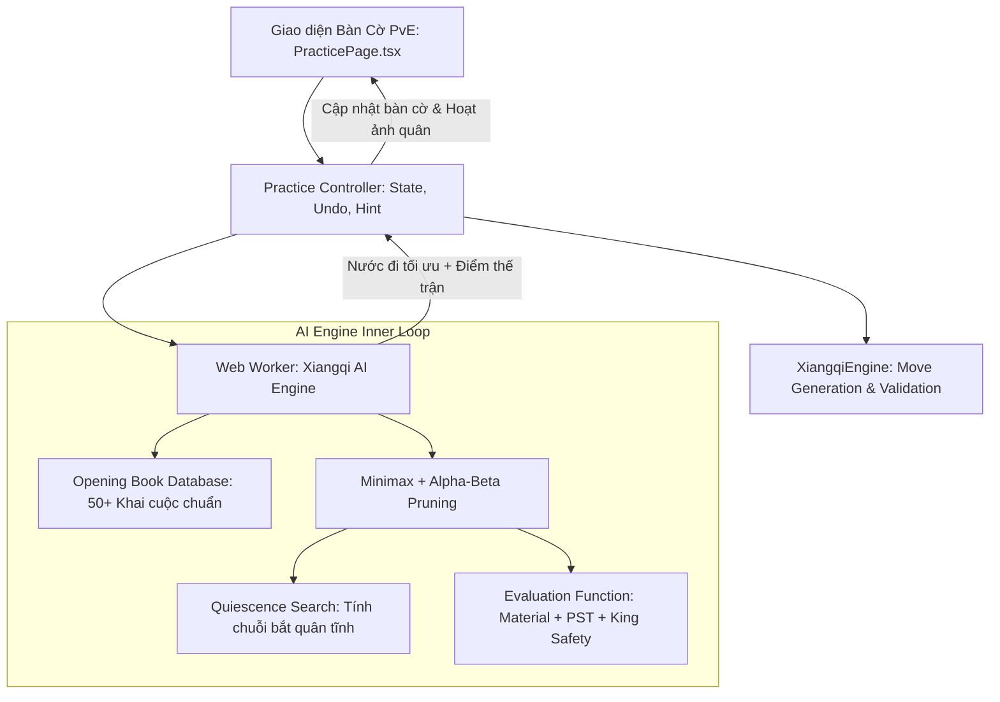

# Kế Hoạch Triển Khai: Chức Năng Luyện Tập Đánh Cờ Với Máy / AI (PvE)

Tài liệu này đặc tả kiến trúc, thuật toán và lộ trình triển khai tính năng **Luyện tập đánh cờ với AI** theo nhiều cấp độ khác nhau, giúp kỳ thủ từ người mới bắt đầu đến trình độ cao thủ có thể rèn luyện chiến thuật mọi lúc mà không cần chờ đối thủ online.

---

## 1. Mục Tiêu & Trải Nghiệm Người Dùng (UX)

- **Không phụ thuộc mạng / Độ trễ 0ms**: Toàn bộ thuật toán AI và logic ván đấu PvE có thể chạy trực tiếp trên Client (thông qua Web Worker hoặc Engine tích hợp) kết hợp lưu kết quả trận đấu về tài khoản người dùng khi có mạng.
- **Tùy chọn phong phú trước trận**:
  - Chọn màu quân: Cầm Đỏ (đi trước) hoặc Cầm Đen (đi sau).
  - Chọn cấp độ AI: Từ Dễ (Mới chơi) đến Kiện tướng (Rất khó).
  - Chọn chế độ thời gian: Có đồng hồ đếm ngược hoặc Không giới hạn thời gian (tập trung suy nghĩ nghiên cứu thế cờ).
- **Bộ công cụ hỗ trợ luyện tập chuyên sâu**:
  - **Đi lại nước cờ (Undo/Takeback)**: Không giới hạn, lùi lại cả nước của mình và nước của AI để thử nghiệm các biến đi khác nhau.
  - **Gợi ý nước đi (Hint)**: Nhờ AI phân tích và chỉ ra 1 nước cờ tối ưu nhất trong tình huống hiện tại.
  - **Thanh đánh giá ưu thế (Evaluation Bar)**: Hiển thị thời gian thực thế cờ đang nghiêng về bên nào (Đỏ +1.5, Đen +3.0...).

---

## 2. Thiết Kế Các Cấp Độ AI (Difficulty Tiers)

| Cấp Độ | Danh Hiệu | Điểm ELO Ước Tính | Độ Sâu Tìm Kiếm (Search Depth) | Cơ Chế & Chiến Thuật |
| :--- | :--- | :--- | :--- | :--- |
| **Cấp 1** | **Tập Chơi (Dễ)** | ~900 - 1100 | Depth = 1 - 2 | Đánh theo bản năng cơ bản, có xác suất 20% đi ngẫu nhiên 1 nước hợp lệ. Thích hợp cho người mới học luật đi và nhớ mặt quân. |
| **Cấp 2** | **Kỳ Thủ Trẻ (Trung Bình)** | ~1200 - 1400 | Depth = 3 | Thuật toán Minimax + Alpha-Beta cơ bản. Tính toán giá trị đổi quân (không bỏ sót quân lớn, biết bảo vệ Xe, Pháo, Mã). |
| **Cấp 3** | **Cao Thủ Kỳ Đạo (Khó)** | ~1600 - 1800 | Depth = 4 + Quiescence Search | Áp dụng bảng vị trí quân cờ (Piece-Square Tables). Biết khống chế lộ thông của Xe, giăng bẫy ngòi Pháo, hạn chế cản Mã. |
| **Cấp 4** | **Đại Sư / Kiện Tướng (Rất Khó)** | ~2000+ | Depth = 5 + Opening Book | Nạp thư viện khai cuộc chuẩn (Thuận Pháo, Bình Phong Mã, Nghịch Pháo, Sĩ Giác Pháo). Tính toán sâu các đòn phối hợp sát cục. |

---

## 3. Kiến Trúc Kỹ Thuật (Architecture & Algorithms)

### 3.1. Hàm Đánh Giá Thế Trận (Evaluation Function)
Điểm số thế cờ = $\text{Score}_{\text{Material}} + \text{Score}_{\text{Position}} + \text{Score}_{\text{Mobility}} + \text{Score}_{\text{KingSafety}}$
- **Giá trị quân cờ cơ bản (Material Values)**:
  - Tướng (帥/將): 100,000 điểm
  - Xe (俥/車): 900 điểm (Quân chủ lực mạnh nhất)
  - Pháo (炮/砲): 450 điểm (Mạnh ở đầu và trung cuộc)
  - Mã (傌/馬): 400 điểm (Mạnh ở trung và tàn cuộc)
  - Tượng (相/象): 200 điểm (Phòng thủ cánh)
  - Sĩ (仕/士): 200 điểm (Bảo vệ Tướng)
  - Binh/Tốt (兵/卒): 100 điểm (Chưa qua sông) $\rightarrow$ 200 điểm (Đã qua sông và áp sát cung)
- **Bảng điểm vị trí (Piece-Square Tables - PST)**:
  - Khuyến khích Xe chiếm các lộ thông 2, 4, 6, 8.
  - Pháo chiếm trung lộ hoặc đóng giác.
  - Mã vươn lên giữa bàn cờ tránh bị cản chân.
  - Tốt tiến thẳng vào cung uy hiếp Tướng.

### 3.2. Web Worker để không giật/lag giao diện
Thuật toán tìm kiếm sâu (Depth 4-5) sẽ được thực thi trong một `Web Worker` ngầm riêng biệt. Trình duyệt chính hoàn toàn mượt mà 60 FPS, không bị đơ chuột hay giật giao diện trong lúc máy đang "suy nghĩ".

---

## 4. Các File & Module Dự Kiến Triển Khai

1. **AI Engine Core (`packages/xiangqi-engine`)**:
   - `packages/xiangqi-engine/src/ai/evaluator.ts`: Hàm chấm điểm vị trí và thế trận.
   - `packages/xiangqi-engine/src/ai/minimax.ts`: Thuật toán tìm kiếm Alpha-Beta Pruning & Quiescence Search.
   - `packages/xiangqi-engine/src/ai/openingBook.ts`: Thư viện nước đi khai cuộc mẫu.
   - `packages/xiangqi-engine/src/ai/aiWorker.ts`: Gói Web Worker xử lý tính toán bất đồng bộ.
2. **Frontend UI (`apps/web`)**:
   - `apps/web/src/pages/PracticePage.tsx`: Trang luyện tập với máy (PvE), bao gồm chọn cấp độ, đồng hồ, nút Đi lại (Undo), Gợi ý (Hint), Bắt đầu lại ván cờ.
   - `apps/web/src/components/EvalBar.tsx`: Cột hiển thị đánh giá ưu thế trực quan màu Đỏ/Đen.
   - Cập nhật [Navbar.tsx](file:///c:/NATA/Workspace/chinise_chess/apps/web/src/components/Navbar.tsx) & [HomePage.tsx](file:///c:/NATA/Workspace/chinise_chess/apps/web/src/pages/HomePage.tsx): Thêm nút "Luyện tập với máy" nổi bật tại trang chủ và menu điều hướng.
3. **Database Integration**:
   - Tùy chọn lưu lại ván đấu luyện tập vào hồ sơ cá nhân để xem lại (Match Replay) khi đăng nhập.

---

## 5. Các Mốc Thực Hiện (Milestones)

- **Giai đoạn 1**: Xây dựng Evaluator (hàm chấm điểm cờ tướng) & thuật toán Minimax Alpha-Beta cấp 1, 2, 3.
- **Giai đoạn 2**: Đóng gói Web Worker & xây dựng giao diện `PracticePage.tsx` với đầy đủ nút Undo, Hint, chọn cấp độ.
- **Giai đoạn 3**: Tích hợp Opening Book cho AI Cấp 4 (Kiện Tướng) & thanh đánh giá thế trận (Eval Bar).
- **Giai đoạn 4**: Kiểm thử độ nhạy, tính chính xác của các nước đi AI và chạy test suite.

